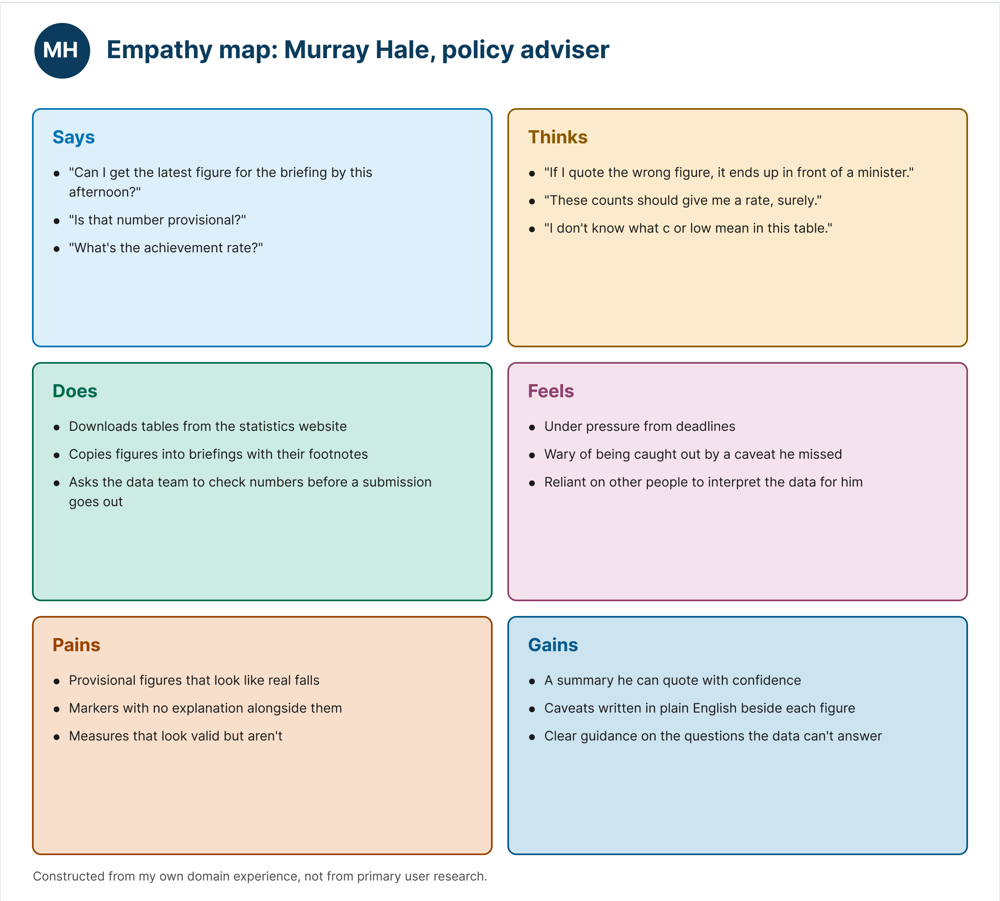
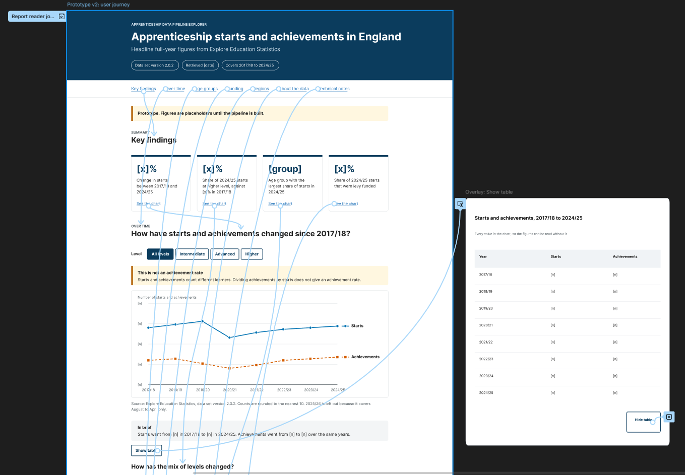
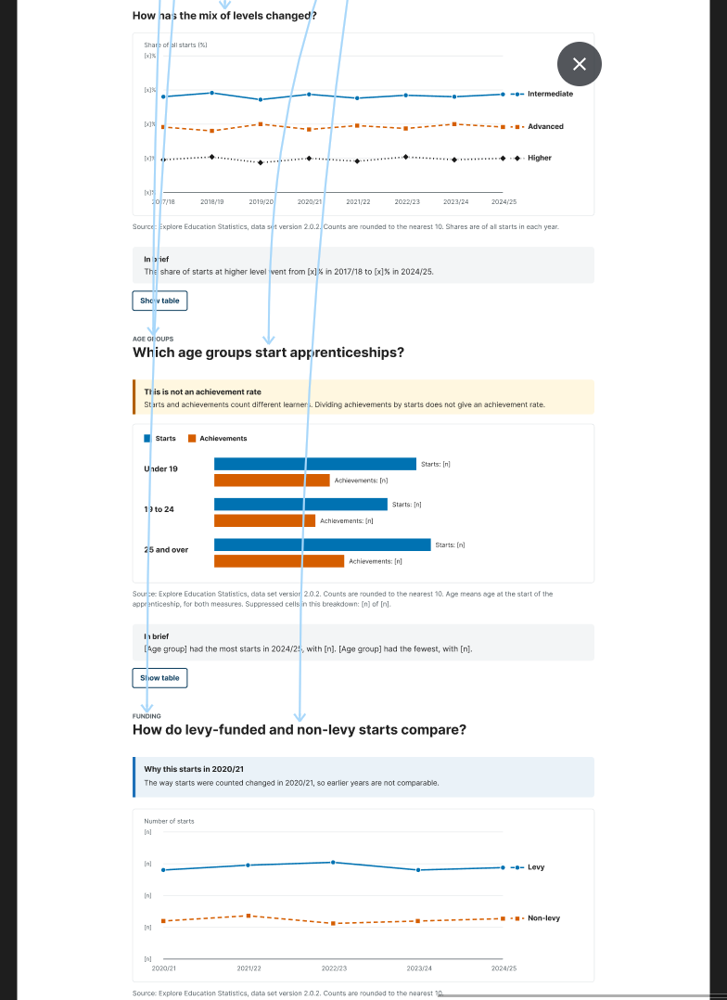
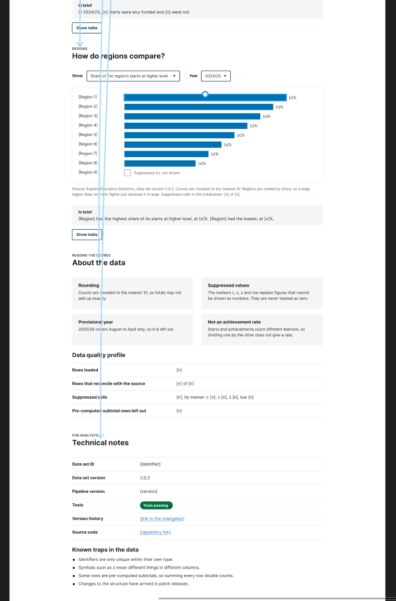
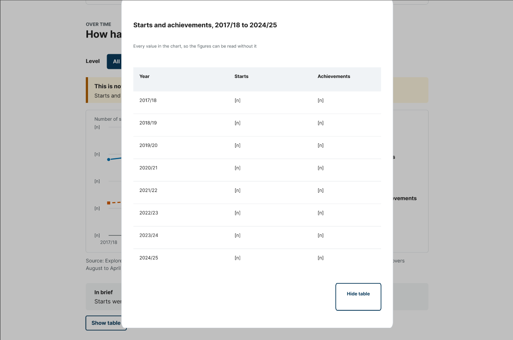
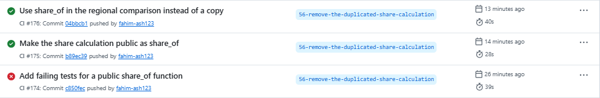
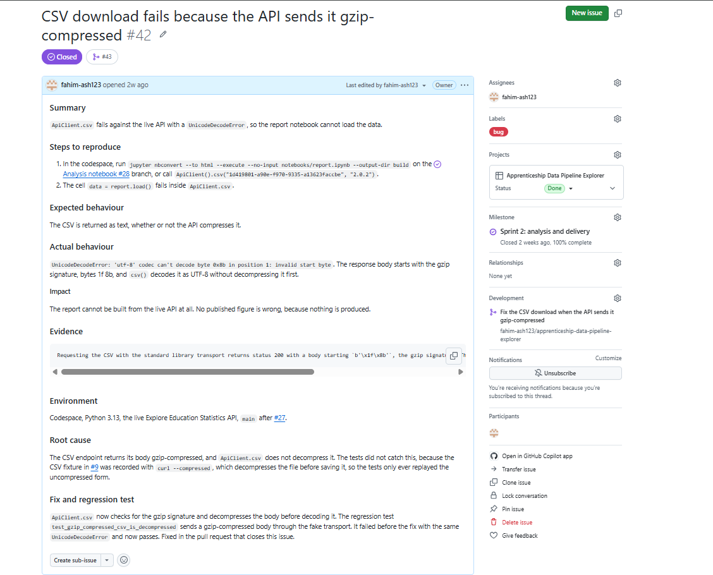

# Apprenticeship Data Pipeline Explorer

[](https://github.com/fahim-ash123/apprenticeship-data-pipeline-explorer/actions/workflows/ci.yml)
[](https://github.com/fahim-ash123/apprenticeship-data-pipeline-explorer/actions/workflows/report.yml)
[](https://fahim-ash123.github.io/apprenticeship-data-pipeline-explorer/coverage.json)

*Table 1: Links to the live report, the project board and the designs.*

| | |
|---|---|
| Live report | https://fahim-ash123.github.io/apprenticeship-data-pipeline-explorer/ |
| Project board | [Apprenticeship Data Pipeline Explorer](https://github.com/users/fahim-ash123/projects/4/views/1) |
| Figma designs | [Apprenticeship Data Pipeline Explorer: design](https://www.figma.com/design/tN8jW4cdfJyDCgD4W03aZT/Apprenticeship-Data-Pipeline-Explorer--design?node-id=0-1&p=f&t=nJ6k8qEgKtCRMMHS-0) |
| Python version | 3.13 |

## 1. The product and the problem

### The business problem

I am a Senior Data Engineer in the Enterprise Data, Funding and Oversight division at the Department for Education (DfE), and my work includes the Individualised Learner Record (ILR), the data collection behind the apprenticeship statistics. DfE publishes these statistics on Explore Education Statistics as ready-made tables and, through a public API, as data files for anyone to analyse (Department for Education, 2026). A table on the website is ready to read, but a file from the API has to be interpreted by its user.

I explored the apprenticeships headline data set through the API and found several features that make a correct answer easy to miss. The file includes pre-computed subtotals, so adding up rows counts the same apprenticeships more than once. Suppressed values are shown as the letters c, x, z and low, and z is also the location code for "Outside of England and unknown". The same academic year is written in three formats, identifiers are unique only within their own type, and the latest year covers August to April only. None of these is an error in the data, but each one turns a reasonable query into a wrong figure. An inflated total could reach a policy briefing, or a regional comparison could favour the largest regions because they are large.

### Purpose and users

The product gives analysts and decision-makers accurate, reproducible figures from the published statistics, without their needing to know how the data set is structured. It has four objectives, which the evaluation returns to:

1. accurate figures, with suppressed values never treated as zero
2. figures reproducible from a stated data set version and set of complete years
3. plain-language findings that readers with colour vision deficiency can use
4. a report that stays current and is published only from tested code

It is a tested Python package whose Jupyter notebook report is published on GitHub Pages, and it serves three roles, each standing for a wider group: a policy analyst who needs quotable figures with their caveats, a delivery manager who needs fair regional comparisons and charts that do not rely on colour, and a data engineer who needs figures reproduced exactly and a clear signal when the publisher changes the data. This README is for the engineers and analysts who maintain the product, and report readers should start with the user documentation.


*Figure 1: The top of the published report, built from the live API.*

## 2. User documentation

The report needs no installation: open the live report link at the top of this page. Its header states the data set version, the retrieval date and the years covered, and the report is rebuilt whenever a change is merged. Each section asks one question, such as how regions compare, and answers it with a chart, followed by a caveat line, a sentence headed "In brief" and a "Show table" list of every value. Read "About the data" before quoting any figure. It explains the rounding, the markers, why the latest year is left out, and why achievements divided by starts is not an achievement rate. The [user guide](docs/user-guide.md) covers each section in full.

## 3. Technical documentation

The project needs Python 3.13. A GitHub Codespace installs everything automatically. Anywhere else, clone the repository and install the package with its pinned dependencies:

```
git clone https://github.com/fahim-ash123/apprenticeship-data-pipeline-explorer.git
```
```
python -m pip install -e ".[dev,report]" -c constraints.txt
```

Run the linter and the tests from the repository's top-level folder:

```
ruff check
```
```
pytest
```

No test calls the live API, because the tests replay real responses recorded in `tests/fixtures`. To build the report locally from the live API:

```
jupyter nbconvert --to html --execute --no-input notebooks/report.ipynb --output-dir build
```

The code is in `src/apprenticeship_explorer`, as single-purpose modules. `client.py` retrieves the data, `parse.py`, `time_period.py`, `window.py` and `selector.py` make each value safe to use, `metrics.py`, `regions.py`, `quality.py` and `versions.py` do the analysis, and `charts.py` and `report.py` build the report. The [technical guide](docs/technical-guide.md) and [architecture document](docs/architecture.md) give the full detail.

## 4. Design

I followed the design thinking stages of empathise, define, ideate, prototype and test (Brown, 2008). Design came before any report code, so the report was built to a reviewed design.

### Empathise and define

I created an illustrative persona for each role, following a simulated research scenario, and an empathy map for the policy analyst, the report's main reader. The personas' goals and frustrations defined the report's structure: eight sections in the order a reader asks the questions.


*Figure 2: The persona for the policy analyst role: Murray Hale, a policy adviser. The [personas document](docs/design/personas.md) holds all three personas and the empathy map, and the [Persona page in Figma](https://www.figma.com/design/tN8jW4cdfJyDCgD4W03aZT/Apprenticeship-Data-Pipeline-Explorer--design?node-id=0-1&p=f&t=nJ6k8qEgKtCRMMHS-0) holds the originals.*



*Figure 3: The empathy map for the policy analyst role, which shaped the report's plain answers and visible caveats.*

### Ideate and prototype

I drew low-fidelity wireframes in Figma for desktop and mobile, with a note beside each section naming the persona it serves and why. Version 1 of the high-fidelity prototype used the Okabe-Ito colour-blind-safe palette (Okabe and Ito, 2008), and I checked every text and background pair against the WCAG 2.2 contrast formula (W3C, 2023). All text reaches at least 4.5:1, and both chart colours exceed the 3:1 minimum for graphics.


*Figure 4: The desktop wireframe, with the persona reasoning for each section in the right-hand column. The [Wireframes page in Figma](https://www.figma.com/design/tN8jW4cdfJyDCgD4W03aZT/Apprenticeship-Data-Pipeline-Explorer--design?node-id=1-54&p=f&t=nJ6k8qEgKtCRMMHS-0) also holds the mobile version.*

### Test

I tested version 1 by walking through it as each persona. This review is illustrative, because it uses the personas rather than real colleagues. It produced nine changes, each carried into a Sprint 2 issue and recorded in the [design document](docs/design/wireframes-and-prototype.md). The most significant ranked regions by the share of their own starts instead of by raw counts, so that large regions no longer looked best. Others placed the rate warning beside the paired charts, and added a chart of level shares and a data quality profile.


*Figure 5: Prototype version 2, after the persona review. The [Prototype page in Figma](https://www.figma.com/design/tN8jW4cdfJyDCgD4W03aZT/Apprenticeship-Data-Pipeline-Explorer--design?node-id=1-208) holds versions 1 and 2 side by side. Its wording "different learners" was corrected to "different apprenticeships" in the built report, after bug #37.*

I then connected an interactive copy of version 2 in Figma. Each contents link and "See the chart" link scrolls to its section, and "Show table" opens the table as an overlay that "Hide table" closes.



*Figure 6: The connected prototype, showing the reader's journey from the contents links and key findings to each section, and from "Show table" to its overlay. The contents and "See the chart" links were designed but not built: the notebook's output has no navigation, so the live report is read by scrolling.*





*Figure 7: Where the journey arrives. Each arrow from Figure 6 ends at the heading of its section, from the mix of levels down to the technical notes.*



*Figure 8: The prototype running, with "Show table" opened as an overlay.*

## 5. Project management

I planned two sprints using Scrum's cadence of planning, delivery, review and retrospective (Schwaber and Sutherland, 2020) on a Kanban board in [GitHub Projects](https://github.com/users/fahim-ash123/projects/4/views/1). As the only developer, I held every Scrum role, so written records replaced meetings: a plan for Sprint 2, and a review and retrospective for each sprint in `docs/sprints`.

The board's five columns run from Backlog to Done. An issue enters Ready only when it has a user story, acceptance criteria, a story-point estimate of my own and a priority, and reaches Done only when its pull request has merged with CI passing. Custom fields hold each issue's sprint, estimate and priority, and built-in workflows move issues as their pull requests open and close. Every tool used was free.


*Figure 9: The project board at the end of Sprint 2.*

*Table 2: Committed and delivered story points for each sprint.*

| Sprint | Dates | Committed points | Delivered points |
|---|---|---|---|
| 1 | 28 September to 6 October | 28 | 28 |
| 2 | 7 to 11 October | 29 | 32, including three 1-point bugs |

Sprint 1 finished five days early, so I closed it and began Sprint 2. During Sprint 1, I brought the design work forward and moved version parsing to Sprint 2. The Sprint 2 backlog came to 36 points, but against a measured velocity of 28, I committed to 29 and moved two lower-priority issues to the backlog, recording why.

After Sprint 2, I took the remaining improvements as continuous Kanban flow instead of a further sprint: a documentation review, a refactor, a coverage badge and the README's illustrations.

Version pinning and a version comparison managed the risk of the publisher changing the data's structure, and each hidden feature of the data became a test. Velocity and descoping managed my limited time alongside full-time work, and branch protection, by making CI a required check, stood in for a second reviewer. The data is published and aggregated, so no personal data is processed.


*Figure 10: The backlog table, showing the two sprints and the two issues left in the backlog.*

## 6. Requirements as issues

Every requirement is an issue written from a template, as a user story with acceptance criteria and a source, such as a finding in the data or a review item. A feature's criteria are ticked only when a named test covers them, so its pull request can point to the evidence, and the [traceability table](docs/traceability.md) maps every delivered issue to the pull request that closed it.


*Figure 11: Issue #25, a requirement written as a user story with testable acceptance criteria.*

## 7. Building the MVP

I built the product in the order its risks demanded. The first issue set up the package, the tests and CI together, so every later change was checked from the start. Sprint 1 then built the data layer one feature at a time, so that each way of getting a wrong figure was removed before any figure reached a user.

*Table 3: The MVP's development, by the date each stage was merged.*

| Date | Pull requests | What was added |
|---|---|---|
| 1 October | #2, #10 | package, CI and marker parser |
| 5 October | #13 to #16 | reviewed design, year normaliser, metadata model |
| 6 October | #17 to #19 | selector, analysis window and API client |
| 8 October | #34 to #36, #38 | version comparison, national trend and mix of starts |
| 9 October | #39, #40 | regional comparison and data quality profile |
| 10 October | #41, #43, #44 | accessible charts and notebook |
| 11 October | #45, #46 | MVP complete: report published from the live API, with documentation |

The real data changed the plan. Recording national rows for the age mix showed that each age group row carries its matching youth or adult value instead of Total, so the selection was redesigned, and the same check found an Unknown level in 2017/18 whose counts were all `low`.

## 8. Test-driven development and CI/CD

I built every feature test first, following the red-green-refactor cycle (Beck, 2003). I pushed each failing test as its own commit, so CI recorded the failure, then pushed the code that made it pass, and each pull request links both runs. Most features took two cycles. The time period normaliser, for example, began with 20 failing tests for the three year formats, malformed values and the 1999/00 century boundary, and a second cycle added sorting.

The research on this practice is mixed. A meta-analysis found a small improvement in external quality and no clear gain in productivity (Rafique and Mišić, 2013), while Fucci et al. (2017) found that short, steady cycles mattered more than writing the test first. My cycles were deliberately small, which fits the second explanation.


*Figure 12: Failing then passing runs for two TDD cycles, as recorded by CI.*

Refactoring followed the same discipline. The regional comparison had its own copy of the share calculation, so I gave the national version its own tests and made it public, then replaced the copy, with every test passing throughout (#56).

```python
# Before: regions.py repeated the missing-value checks
if isinstance(count, Missing):
    return RegionShare(code, name, count), missing
if isinstance(total, Missing):
    return RegionShare(code, name, total), missing
return RegionShare(code, name, 100 * count / total), missing
```

```python
# After: one shared, tested function
return RegionShare(code, name, share_of(count, total)), missing
```



*Figure 13: Red, green, then refactor, as recorded by CI for #56.*

Continuous integration runs on every push and pull request (Fowler, 2006). It checks the code with Ruff, a static analysis tool, and runs all 238 tests with 100% coverage, shown by the coverage badge, and branch protection blocks any merge into `main` until the check passes. Deployment is continuous too: a second workflow starts only when CI succeeds on a push to `main`, builds the notebook from the live API and publishes it to GitHub Pages. Every dependency is pinned in `constraints.txt`, so the build is the same in CI as in a codespace.


*Figure 14: The report workflow publishing to GitHub Pages after CI passed.*

## 9. Features, branches and bug tickets

Each feature followed one issue, one branch and one pull request. I created every branch from its issue, so its name begins with the issue number, and merged with a merge commit, so the history shows each feature as a unit. The pull request template records the changes, the testing and the documentation, and `Closes #` links each pull request to its issue.

Bug tickets use a separate template, because a bug needs different information: the steps to reproduce it, the expected and actual behaviour, the evidence, the root cause, and the fix with its regression test. All three bugs were fixed test first. They were found by reading the footnotes in full (#37), by the first live run of the report (#42) and by reading the published page (#47). For #42, this regression test failed with the live error before the fix below it.

```python
def test_gzip_compressed_csv_is_decompressed():
    """The live CSV endpoint sends its body gzip-compressed, so it is decompressed first."""
    body = gzip.compress(b"\xef\xbb\xbftime_period,start_count\n202425,353500\n")
    text = ApiClient(FakeTransport(ok(body))).csv("abc", version="2.0.2")
    assert text == "time_period,start_count\n202425,353500\n"
```

```python
body = self._get(f"/data-sets/{data_set_id}/csv", _version_param(version))
if body[:2] == GZIP_SIGNATURE:
    body = gzip.decompress(body)
return body.decode("utf-8-sig")
```



*Figure 15: Bug #42, documented with the bug template.*

## 10. Evaluation

The product meets its four objectives, each with a limit. Figures are accurate: each is read from one published row and tested against real values, such as the 353,500 national starts in 2024/25. A share calculated from rounded counts can still differ from a published percentage by up to 0.1 points, because the publisher uses unrounded counts. Figures are reproducible from a pinned version, but the report does not yet notice new versions, so staying current depends on someone changing the pin. The charts meet the WCAG 2.2 contrast minimums and never rely on colour alone, but they have not been tested with a screen reader or by real users.

The clearest lesson concerns verification and validation. The tests verified that the client behaved as specified, and all of them passed while it could not download the live CSV, because the fixture had been recorded in a form the API never sends. Only running the product against the live service validated it. I would now record fixtures through the client itself and add a scheduled check against the live API.

The design has a similar limit. Illustrative personas let me design for real roles, but they cannot reveal needs I had not anticipated, and two persona needs remain unmet: a breakdown by provider type, and reconciliation with the source totals.

Splitting the package into single-purpose modules (Martin, 2000) let each feature of the data be tested in isolation, and a single package suits a product of this size better than separate services (Richards, 2015). The metadata model, however, is tested but unused, because the CSV carries labels instead of identifiers, and building it early cost three points. Current practice suggests two improvements. Checking each response against a declared schema, as a data contract does (Jones, 2023), would catch a publisher's change when the data loads. The pinned dependencies are only a first step towards the build provenance that the SLSA framework describes (Open Source Security Foundation, 2023).

The planning held, and descoping against velocity left room for three unplanned bugs, although my own process slipped twice: a fixture was left out of one feature's commits, and a pull request named the wrong issue. In a team, a second reviewer would join CI on every merge, and covering more data sets would mean moving the fixed data set identifier and filter names into configuration.

To sum up, the product turns a data set that is easy to misread into a tested, reproducible and accessible report. In order of priority, the next steps are testing the report with its users, live checks against the API, detecting new versions, the two unmet persona needs, the designed contents links, and the two backlog issues, #31 and #32.

## References

Beck, K. (2003) *Test-driven development: by example*. Boston: Addison-Wesley.

Brown, T. (2008) 'Design thinking', *Harvard Business Review*, 86(6), pp. 84-92.

Department for Education (2026) *Apprenticeships: headline full year, starts, achievements and participation*. Explore Education Statistics. Available at: https://explore-education-statistics.service.gov.uk/data-catalogue/data-set/26f76d9a-8700-4776-bbf6-9a1c963e607b (Accessed: 11 October 2026).

Fucci, D., Erdogmus, H., Turhan, B., Oivo, M. and Juristo, N. (2017) 'A dissection of the test-driven development process: does it really matter to test-first or to test-last?', *IEEE Transactions on Software Engineering*, 43(7), pp. 597-614. Available at: https://doi.org/10.1109/TSE.2016.2616877 (Accessed: 25 October 2026).

Fowler, M. (2006) *Continuous integration*. Available at: https://martinfowler.com/articles/continuousIntegration.html (Accessed: 11 October 2026).

Jones, A. (2023) *Driving data quality with data contracts*. Birmingham: Packt Publishing.

Martin, R.C. (2000) *Design principles and design patterns*. Available at: http://staff.cs.utu.fi/~jounsmed/doos_06/material/DesignPrinciplesAndPatterns.pdf (Accessed: 11 October 2026).

Okabe, M. and Ito, K. (2008) *Color universal design (CUD): how to make figures and presentations that are friendly to colorblind people*. Available at: https://jfly.uni-koeln.de/color/ (Accessed: 11 October 2026).

Open Source Security Foundation (2023) *SLSA specification v1.0*. Available at: https://slsa.dev/spec/v1.0/ (Accessed: 12 October 2026).

Rafique, Y. and Mišić, V.B. (2013) 'The effects of test-driven development on external quality and productivity: a meta-analysis', *IEEE Transactions on Software Engineering*, 39(6), pp. 835-856. Available at: https://doi.org/10.1109/TSE.2012.28 (Accessed: 25 October 2026).

Richards, M. (2015) *Software architecture patterns*. Sebastopol, CA: O'Reilly Media.

Schwaber, K. and Sutherland, J. (2020) *The Scrum guide*. Available at: https://scrumguides.org/scrum-guide.html (Accessed: 11 October 2026).

W3C (2023) *Web content accessibility guidelines (WCAG) 2.2*. Available at: https://www.w3.org/TR/WCAG22/ (Accessed: 11 October 2026).