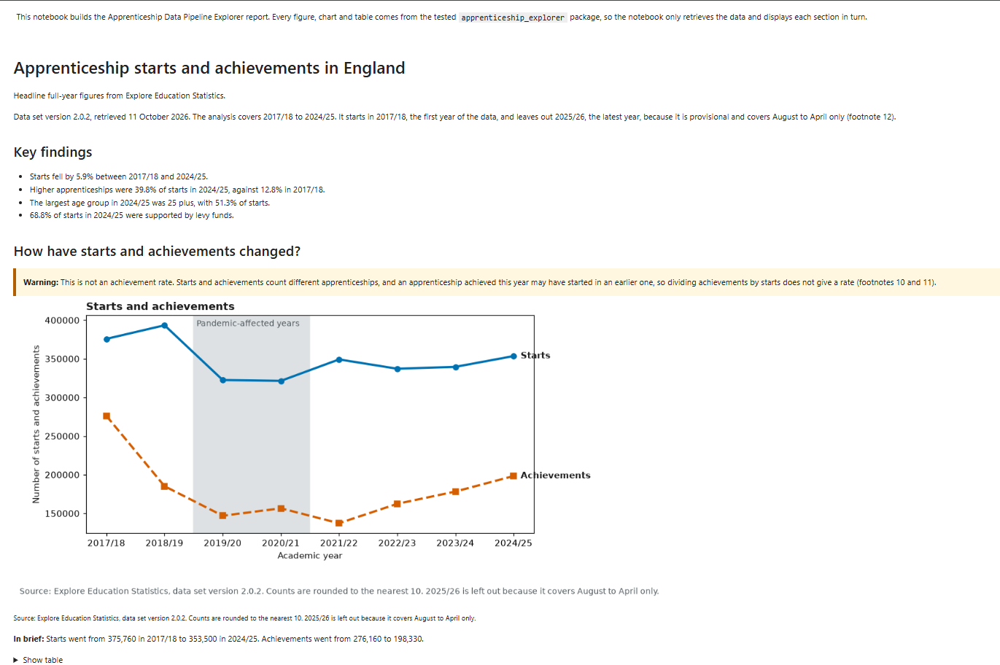
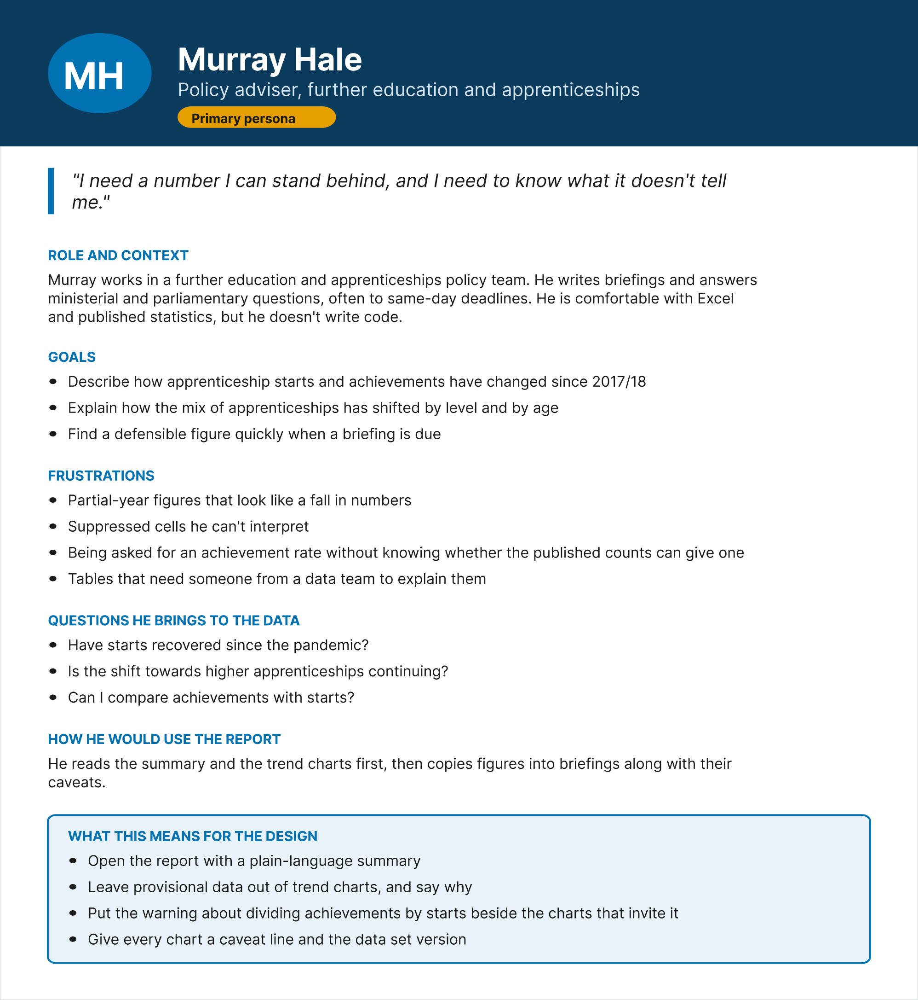
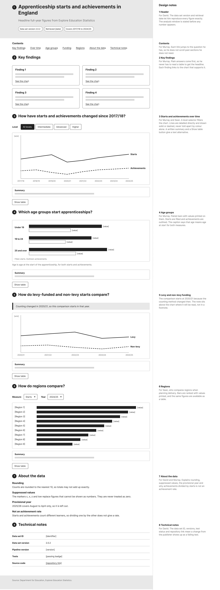
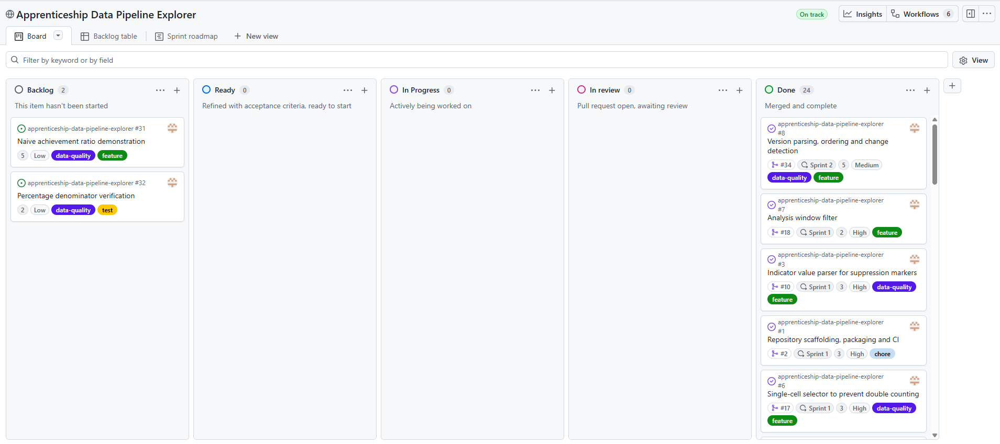
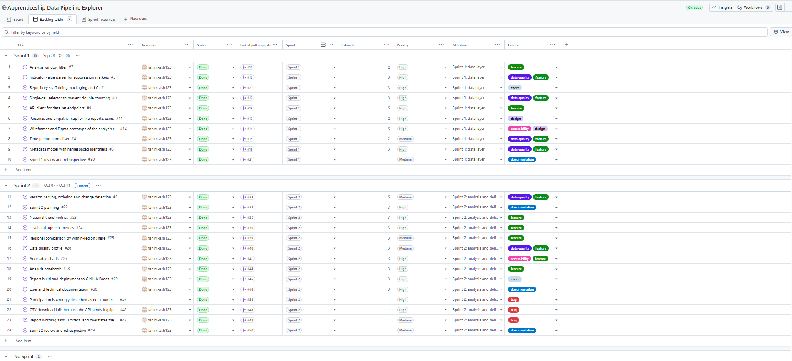
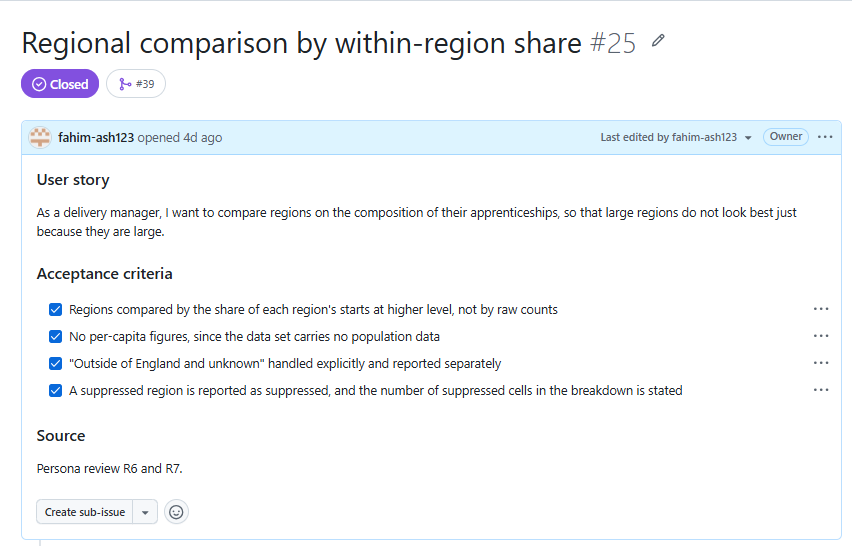
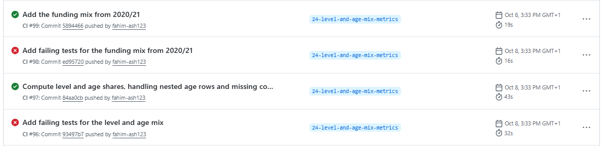
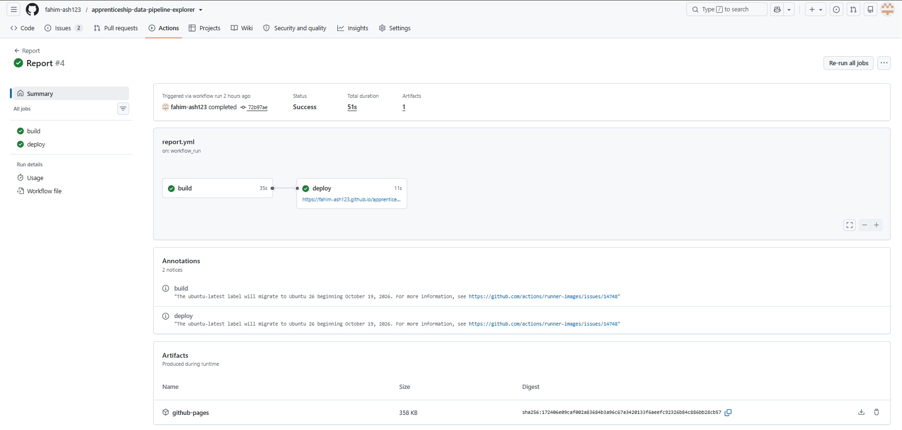

# Apprenticeship Data Pipeline Explorer

[](https://github.com/fahim-ash123/apprenticeship-data-pipeline-explorer/actions/workflows/ci.yml)
[](https://github.com/fahim-ash123/apprenticeship-data-pipeline-explorer/actions/workflows/report.yml)

| | |
|---|---|
| Live report | https://fahim-ash123.github.io/apprenticeship-data-pipeline-explorer/ |
| Project board | [Apprenticeship Data Pipeline Explorer](https://github.com/users/fahim-ash123/projects/4/views/1) |
| Figma designs | [Apprenticeship Data Pipeline Explorer: design](https://www.figma.com/design/tN8jW4cdfJyDCgD4W03aZT/Apprenticeship-Data-Pipeline-Explorer--design?node-id=0-1&p=f&t=nJ6k8qEgKtCRMMHS-0) |
| Python version | 3.13 |

## 1. The product and the problem

### The business problem

I am a Senior Data Engineer in the Enterprise Data, Funding and Oversight division at the Department for Education (DfE), and my work includes the Individualised Learner Record (ILR), the data collection behind the apprenticeship statistics. DfE publishes these statistics on Explore Education Statistics, as ready-made tables and, through a public API, as data files anyone can load into their own analysis (Department for Education, 2026). A table on the website is presented ready to read. A file from the API is not, and interpreting it correctly is left to the user.

Before writing any code, I explored the apprenticeships headline data set through the API and found several features that make a correct answer easy to miss. The file includes pre-computed subtotals, so adding up rows counts the same apprenticeships more than once. Suppressed values are shown as the letters c, x, z and low, and z is also the location code for "Outside of England and unknown". The same academic year is written in three formats, identifiers are unique only within their own type, and the latest year covers August to April only.

None of these is an error in the data, but each one turns a reasonable query into a wrong figure. An inflated total could reach a policy briefing, or a regional comparison could favour the largest regions because they are large. Every analyst using the API also has to find these features themselves.

### Purpose

The product gives analysts and decision-makers accurate, reproducible figures from the published apprenticeship statistics, without their needing to know how the data set is structured. It has four objectives, which I return to in the evaluation:

1. Every figure is accurate, and suppressed values are never treated as zero.
2. Every figure can be reproduced, from a stated data set version and a stated set of complete years.
3. The findings are presented in plain language and can be read by people with colour vision deficiency.
4. The report stays up to date and is only ever published from code that has passed its tests.

### How the product meets the objectives

| Objective | How it is met |
|---|---|
| 1. Accurate | Each figure is read from exactly one published row, markers are kept as missing values with their reason, and each type of identifier has its own namespace |
| 2. Reproducible | The API client pins version 2.0.2, the report states the version and retrieval date, and a rule leaves out the latest, partial year whatever it is |
| 3. Clear and accessible | The report is organised around its users' questions, and every chart has direct labels, distinct line styles and markers, a colour-blind-safe palette, a written summary and a table |
| 4. Current and tested | A GitHub Actions workflow rebuilds and publishes the report on every merge to `main`, and only after the linter and all 232 tests have passed |

### Who it is for

The product, a Python package and a notebook report published on GitHub Pages, is for three roles that use the apprenticeship statistics in their work. Each represents a wider group, so the benefit reaches the teams and decision-makers who depend on their work, not only the individuals who open the report. The design section describes the persona developed for each role.

| Role | Their need | How the product helps |
|---|---|---|
| **Policy analyst** | Quotable figures for briefings, without reading code or raw tables, and confidence that each figure is correct | Key findings in plain language, a caveat line under every chart to quote with the figure, and a warning wherever starts and achievements appear together, so they are not divided into a false rate |
| **Delivery manager** | A fair comparison of regions for planning delivery, and charts that can be read without relying on colour, including by people with colour vision deficiency | Regions ranked by the share of their own starts, not raw counts, suppressed cells stated in each breakdown, and charts told apart by line style, marker and label as well as colour |
| **Data engineer** | A pipeline that reproduces figures exactly, and a clear signal when the publisher changes the data | A pinned data set version and retrieval date, a version history comparing each version's filters and indicators, and tests that fail if the code stops handling a known feature of the data |

Together, these turn a file each user has to interpret into a report they can read, quote and rely on.



*Figure 1: The top of the published report, built from the live API.*

## 2. User documentation

The report needs no installation: open the live report link at the top of this page. The header states the data set version, the date the data was retrieved and the years covered. The report is rebuilt whenever a change is merged, so the retrieval date shows how current it is. The key findings follow in plain language, and each later section asks one question, such as how regions compare, and answers it with a chart.

Under every chart is a caveat line with the source and rounding, a sentence headed "In brief" with the main figures, and a "Show table" list of every value, so the figures are available without reading the chart. Read "About the data" before quoting any figure. It explains the rounding, what each marker means, why the latest year is left out, and why achievements divided by starts is not an achievement rate. The [user guide](docs/user-guide.md) covers each section and limitation in full.

## 3. Technical documentation

The project needs Python 3.13. A GitHub Codespace installs everything automatically. Anywhere else, clone the repository and install the package with its pinned dependencies:

```
git clone https://github.com/fahim-ash123/apprenticeship-data-pipeline-explorer.git
```
```
python -m pip install -e ".[dev,report]" -c constraints.txt
```

Run the linter and the tests from the repository's top-level folder:

```
ruff check
```
```
pytest
```

No test calls the live API. Tests that need real responses replay files recorded in `tests/fixtures`, so the results are the same on every run. To build the report locally from the live API:

```
jupyter nbconvert --to html --execute --no-input notebooks/report.ipynb --output-dir build
```

| Folder | Contents |
|---|---|
| `src/apprenticeship_explorer` | The package, in twelve modules, from the API client to the report sections |
| `tests` | 232 tests and the recorded fixtures |
| `notebooks` | The report notebook, which only calls the package |
| `docs` | The user guide, technical guide, architecture, traceability, design and sprint records |
| `.github` | The CI and report workflows, and the issue and pull request templates |

The [technical guide](docs/technical-guide.md) explains the automation and how to add a report section. The [architecture document](docs/architecture.md) describes each module and shows the data flow and deployment.

## 4. Design

I followed the design thinking process taught in the course: empathise, define, ideate, prototype and test (Brown, 2008). Design came before any report code, so the report was built to a reviewed design.

### Empathise and define

I created an illustrative persona for each role, following a simulated research scenario, and an empathy map for the policy analyst, the report's main reader. Each persona records the user's goals, frustrations and what the design must do for them. Together they defined the report's structure: eight sections in the order a reader asks the questions, from the key findings to the technical notes.



*Figure 2: The persona for the policy analyst role: Murray Hale, a policy adviser. The [personas document](docs/design/personas.md) holds all three personas and the empathy map, and the [Persona page in Figma](https://www.figma.com/design/tN8jW4cdfJyDCgD4W03aZT/Apprenticeship-Data-Pipeline-Explorer--design?node-id=0-1&p=f&t=nJ6k8qEgKtCRMMHS-0) holds the originals.*

### Ideate and prototype

I drew low-fidelity wireframes in Figma for desktop and mobile, with a design note beside each section recording which persona it serves and why. I then built version 1 of a high-fidelity prototype, using the Okabe-Ito colour-blind-safe palette (Okabe and Ito, 2008), and checked every text and background pair against the WCAG 2.2 contrast formula (W3C, 2023). All text reaches at least 4.5:1, and the two chart colours exceed the 3:1 minimum for graphics.



*Figure 3: The desktop wireframe, with the persona reasoning for each section in the right-hand column. The [Wireframes page in Figma](https://www.figma.com/design/tN8jW4cdfJyDCgD4W03aZT/Apprenticeship-Data-Pipeline-Explorer--design?node-id=1-54&p=f&t=nJ6k8qEgKtCRMMHS-0) also holds the mobile version.*

### Test

I tested version 1 by walking through it as each persona, against the needs on their card. This review is illustrative: it uses the personas, not interviews with real colleagues, which I discuss in the evaluation. It found nine changes, each recorded in the [design document](docs/design/wireframes-and-prototype.md) and carried into a Sprint 2 issue. The most significant was ranking regions by share instead of by count.

| Review item | Finding in version 1 | Change in version 2 |
|---|---|---|
| R1 | The warning against dividing achievements by starts was only in "About the data" | The warning sits beside the charts that pair the two measures |
| R4 | The level selector showed one level at a time, so the shift towards higher apprenticeships was invisible | A new chart shows each level's share of starts over time |
| R6 | Regions were ranked by raw counts, so the largest regions looked best | Regions are ranked by the share of their own starts |
| R8 | There was no record of how much of the data is suppressed | A data quality profile was added |


*Figure 4: Prototype version 2, after the persona review. The [Prototype page in Figma](https://www.figma.com/design/tN8jW4cdfJyDCgD4W03aZT/Apprenticeship-Data-Pipeline-Explorer--design?node-id=1-208) holds versions 1 and 2 side by side. Its wording "different learners" was corrected to "different apprenticeships" in the built report, after bug #37.*

## 5. Project management

I planned the project as two sprints, using Scrum's cadence of planning, delivery, review and retrospective (Schwaber and Sutherland, 2020) on a Kanban board in [GitHub Projects](https://github.com/users/fahim-ash123/projects/4/views/1). As the only developer, I held all three Scrum roles myself, so I relied on written records in place of meetings: a planning document before Sprint 2, and a review and retrospective after each sprint in `docs/sprints`.

The board has five columns, from Backlog to Done, and each column has an entry rule. An issue moves to Ready only when it has a user story, acceptance criteria, an estimate and a priority, and to Done only when its pull request has merged with CI passing. Custom fields hold each issue's sprint, story points and priority, and three views show the board, a backlog table grouped by sprint, and a roadmap. Built-in workflows move an issue to In review when a pull request is linked, and to Done when it closes. Every tool was free, and Figma's free plan limited the file to three pages, so both prototype versions share one.



*Figure 5: The project board at the end of Sprint 2.*

During Sprint 1, I brought the design work forward and moved version parsing to Sprint 2 to stay within capacity. The sprint delivered 28 points and finished five days early, so I closed it and started Sprint 2. At planning, the remaining backlog came to 36 points. Against a velocity of 28, committing to 36 would have been planning to fail, so I committed to 29 and moved two lower-priority issues to the backlog, recording why. Sprint 2 delivered all 29 points, plus three single-point bugs found during the sprint.

| Risk | How I managed it |
|---|---|
| The publisher changes the data's structure | The version is pinned, and the report compares each version's filters and indicators |
| Hidden features of the data produce wrong figures | Each feature found became a test against recorded real responses |
| Limited time alongside full-time work | Commitments were set from measured velocity, and lower-value work was descoped first |
| No second reviewer for code | Branch protection makes CI a required check on every merge |
| Handling of data | The data set holds published, aggregated statistics, so no personal data is processed |



*Figure 6: The backlog table, showing the two sprints and the two issues left in the backlog.*

## 6. Requirements as issues

Every requirement is an issue written from a template, as a user story with acceptance criteria and a source, such as a finding in the data or a persona review item. Labels mark the type of work, such as `feature`, `data-quality`, `accessibility` or `bug`. A feature's acceptance criterion is ticked only when a named test covers it, so the pull request can point to the evidence for each one. The [traceability table](docs/traceability.md) maps every delivered issue to the pull request that closed it.



*Figure 7: Issue #25, a requirement written as a user story with testable acceptance criteria.*

## 7. Building the MVP

I built the product in the order its risks demanded. The first issue set up the package, the tests and CI together, so every later change was checked from the start. Sprint 1 then built the data layer, one feature of the data at a time: a parser for the markers, a normaliser for the three year formats, a metadata model with separate namespaces, a selector that reads exactly one row, a rule for the analysis window, and the API client. Each removed one way of getting a wrong figure before any figure was shown to a user.

Sprint 2 built the analysis on that layer: the national trend, the level, age and funding mix, the regional comparison and the data quality profile, then the accessible charts, the notebook, the deployment and the documentation. The notebook only calls the package, and a test fails if any cell defines a function or a loop, so every calculation stays under test.

The real data kept changing the plan. Recording national rows for the age mix showed that each age group row carries its matching youth or adult value instead of Total, so the selection had to be redesigned. The same check found an Unknown level in 2017/18 whose counts were all `low`. The MVP was complete on 11 October 2026, when the report was first published from the live API.

## 8. Test-driven development and CI/CD

I built every feature test first, following the red-green-refactor cycle (Beck, 2003). I pushed each failing test as its own commit, so CI recorded the failure, then pushed the code that made it pass, and each pull request links both runs. Most features took two cycles, the second covering the edge cases. The time period normaliser, for example, began with 20 failing tests covering the three year formats, malformed values and the 1999/00 century boundary, and a second cycle added chronological sorting. I refactored inside the green step, with the tests as a safety net.



*Figure 8: Failing then passing runs for two TDD cycles, as recorded by CI.*

Continuous integration runs on every push and pull request (Fowler, 2006). It checks the code with Ruff, a static analysis tool, and runs all 232 tests with coverage, which is at 100%. Branch protection means nothing merges into `main` until the check passes. Deployment is continuous too: a second workflow starts only when CI succeeds on a push to `main`, builds the notebook from the live API and publishes it to GitHub Pages. Every dependency is pinned in `constraints.txt`, so the build is the same in CI as in a codespace.



*Figure 9: The report workflow publishing to GitHub Pages after CI passed.*

## 9. Features, branches and bug tickets

Each feature followed one issue, one branch and one pull request. I created every branch from its issue, so its name begins with the issue number, and merged with a merge commit, so the history shows each feature as a unit. The pull request template asks for a summary, the changes, how they were tested and the documentation updated, and `Closes #` links the pull request to its issue.

Bug tickets use a separate template, because a bug needs different information from a feature: the steps to reproduce it, the expected and actual behaviour, the evidence, the root cause, and the fix with its regression test. Each bug was fixed test first.

| Bug | Found by | Root cause |
|---|---|---|
| #37 Participation described as not counting learners | Reading the footnotes in full | Footnotes about starts were applied to participation |
| #42 CSV download fails | The first run of the report against the live API | The API sends the CSV compressed, and the fixture had been recorded already decompressed |
| #47 "1 filters" and an overstated version history | Reading the published report | A fixed plural, and text that did not state the comparison's scope |

## 10. Evaluation

The product meets its four objectives, with limits on each. Figures are accurate: each is read from one published row, and the tests check them against real values, such as the 353,500 national starts in 2024/25. A share worked out from rounded counts can still differ from a published percentage by up to 0.1 points, because the publisher calculates on unrounded counts. Figures are reproducible from a pinned version, but the report does not yet notice when a new version is published, so staying current still depends on someone changing the pin. The charts meet the WCAG 2.2 contrast minimums and never rely on colour alone, but they have not been tested with a screen reader or by real users.

The clearest lesson is the difference between verification and validation. The tests verified that the client behaved as specified, and all of them passed while the client could not download the live CSV. The fixture had been recorded with a tool that decompressed it, so the tests checked the code against a response the API never sends. Recorded responses are only as faithful as their recording, and only running the product against the live service validated it. In future I would record fixtures through the same code that makes the real request, and run a scheduled check against the live API.

The design has the same kind of limit. Illustrative personas let me design for real roles, but they cannot surface a need I had not already anticipated, which is why testing version 2 with real colleagues is the next step.

Splitting the package into single-purpose modules (Martin, 2000) let each feature of the data be tested in isolation, and a single deployable package suits a product of this size better than separate services (Richards, 2015). One module, the metadata model, is tested but unused, because the CSV carries labels instead of identifiers. Building it before it was needed cost three points that a later feature could have used.

The planning held: both sprints met their commitments, and descoping against velocity left room for three unplanned bugs. My own process was less consistent. A fixture left out of one feature's commits and a wrong issue number in a pull request both needed correcting, and checking `git status` before every commit stopped the first from recurring. Each limit identified in this evaluation points to a next step, and the table below sets them out in order of priority.

### Future work

| Priority | Next step | Why | Source |
|---|---|---|---|
| 1 | Test version 2 of the report with colleagues in each role, including a screen reader user | The personas and the review were illustrative, so the design has not yet been validated by real users | Design limits in this evaluation |
| 2 | Record fixtures through the client itself, and add a scheduled check against the live API | The gzip bug passed every test because the fixture did not match what the API sends | Bug #42 |
| 3 | Detect when a new version of the data set is published, and flag it in the report | Staying current still depends on someone changing the pinned version | Objective 2 in this evaluation |
| 4 | Compare filter options and row counts between versions, as well as filters and indicators | Version 2.0 deleted provider type options and 1.0.2 added rows, but the version history cannot show either | Bug #47 |
| 5 | Deliver the naive achievement ratio demonstration and the percentage denominator verification | Both were descoped at Sprint 2 planning to fit capacity, and remain in the backlog | Issues #31 and #32 |
| 6 | Add a breakdown of starts by provider type | The delivery manager persona asks which provider types are driving change, which the report does not yet answer | Persona: delivery manager |
| 7 | Reconcile the rows read with the source totals in the data quality profile | The data engineer persona asks whether every row reconciles with the source, and prototype version 2 showed it, but the built profile does not | Persona: data engineer |

## References

Beck, K. (2003) *Test-driven development: by example*. Boston: Addison-Wesley.

Brown, T. (2008) 'Design thinking', *Harvard Business Review*, 86(6), pp. 84-92.

Department for Education (2026) *Apprenticeships: headline full year, starts, achievements and participation*. Explore Education Statistics. Available at: https://explore-education-statistics.service.gov.uk/data-catalogue/data-set/26f76d9a-8700-4776-bbf6-9a1c963e607b (Accessed: 11 October 2026).

Fowler, M. (2006) *Continuous integration*. Available at: https://martinfowler.com/articles/continuousIntegration.html (Accessed: 11 October 2026).

Martin, R.C. (2000) *Design principles and design patterns*. Available at: http://staff.cs.utu.fi/~jounsmed/doos_06/material/DesignPrinciplesAndPatterns.pdf (Accessed: 11 October 2026).

Okabe, M. and Ito, K. (2008) *Color universal design (CUD): how to make figures and presentations that are friendly to colorblind people*. Available at: https://jfly.uni-koeln.de/color/ (Accessed: 11 October 2026).

Richards, M. (2015) *Software architecture patterns*. Sebastopol, CA: O'Reilly Media.

Schwaber, K. and Sutherland, J. (2020) *The Scrum guide*. Available at: https://scrumguides.org/scrum-guide.html (Accessed: 11 October 2026).

W3C (2023) *Web content accessibility guidelines (WCAG) 2.2*. Available at: https://www.w3.org/TR/WCAG22/ (Accessed: 11 October 2026).