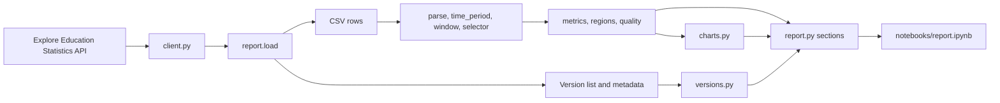
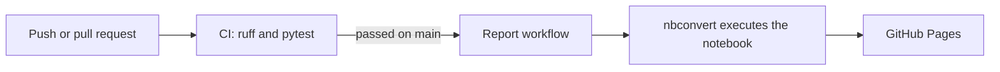

# Architecture

The product is a tested Python package, `apprenticeship_explorer`, and a notebook that displays what the package produces. All analytical logic is in the package, where it is tested. The notebook only loads the data and displays each section.

## Modules

| Module | Responsibility |
|---|---|
| `client.py` | Retrieves the summary, metadata, versions and CSV from the API, with a timeout, retries for server errors and lost connections, and gzip decompression for the CSV |
| `parse.py` | Turns indicator values into numbers, or into missing values that keep their marker and reason |
| `time_period.py` | Normalises the three ways the API writes an academic year into one comparable value |
| `window.py` | Limits the analysis to complete years, leaving out the latest, provisional one |
| `selector.py` | Reads each figure from exactly one row, so subtotals are never added together |
| `metrics.py` | The national trend, and the level, age and funding mix |
| `regions.py` | Ranks regions by within-region share, reporting "Outside of England and unknown" separately |
| `quality.py` | Profiles the markers by indicator, by breakdown and by granularity |
| `versions.py` | Parses and orders versions, and compares the filters and indicators of two versions |
| `charts.py` | Draws accessible line and bar charts |
| `report.py` | Builds each section of the report from the modules above |
| `metadata.py` | A tested model of the `/meta` response with a separate namespace for each identifier type |

The report does not use `metadata.py`. The CSV carries labels, not identifiers, so the report reads labels directly from the rows, and the version comparison reads the raw metadata. The model remains available for analysis that needs to resolve identifiers.

## Data flow

## Build and deployment

A failed CI run, or a run for a pull request, never starts the build, so the published report always comes from code that has passed every test.